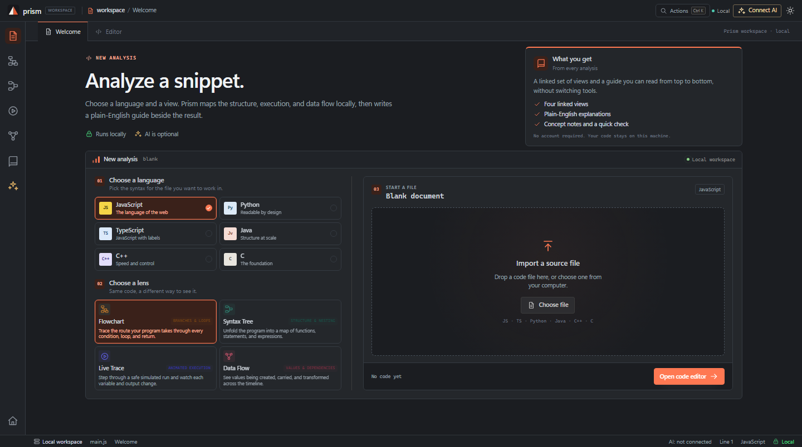
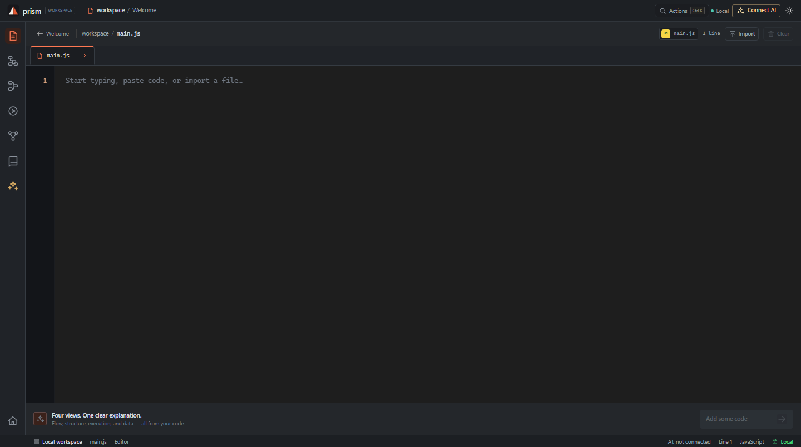
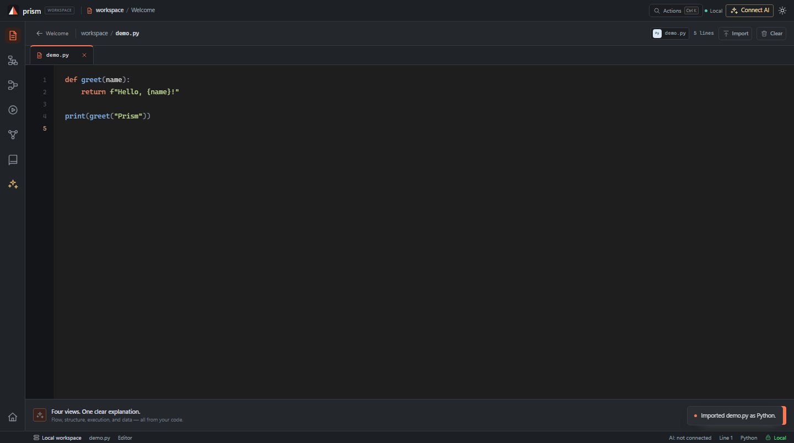
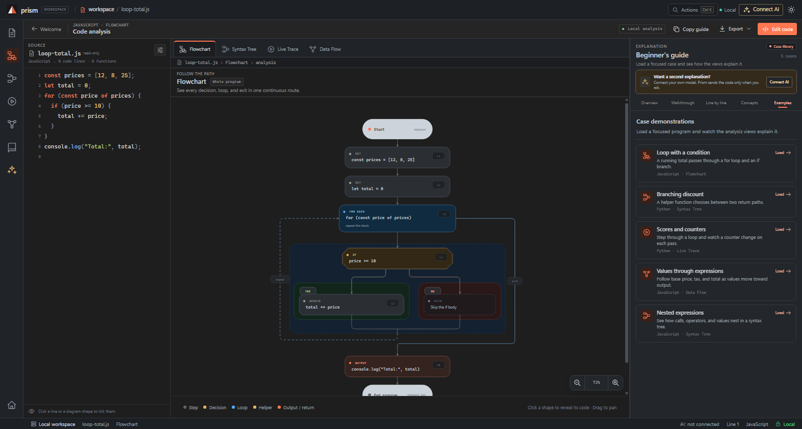

# Prism — code analysis workspace

Prism is a local-first code visualizer for people who are learning to program. Pick a language, paste a snippet, choose a lens, and get four linked views plus a beginner-friendly guide that explains the program line by line. The workbench uses a restrained, product-neutral layout: a project bar, a compact view rail, a source/visual/guide workspace, rounded editor tabs, breadcrumbs, quick actions, and a quiet status bar.

- **Flowchart** — follow branches, loops, helper calls, and exits.
- **Syntax Tree** — explore the structure of statements and expressions in a collapsible tree.
- **Live Trace** — play back a safe, simulated execution and watch values and output change.
- **Data Flow** — follow how values move from the line that creates them to the line that uses them.
- **Beginner's guide** — overview, mental model, walkthrough, line-by-line notes, concepts, pitfalls, and quiz questions.
- **Case demonstrations** — open the guide from the left rail to load a flow, data, syntax, or trace case with one click. Five small programs are included.
- **Bring your own AI** — connect OpenAI, DeepSeek, xAI Grok, Anthropic, Gemini, or another OpenAI-compatible endpoint through a small local proxy. The app works without AI; the AI path is entirely optional.
- **Quick actions** — press **Ctrl+K** (or **Ctrl+Shift+P**) to run any view, open the guide, connect AI, copy/export, or switch theme.

The entire interface is in English. Prism now runs as a **Python desktop application**: the native window, local HTTP server, AI proxy, single-instance handling and packaging are Python (PySide6), while the rendered workspace runs locally in the bundled Qt WebEngine view. Code is sent to a model only when you explicitly press **Enhance guide** (or test a connection).

### Python analysis path

Python source files now use a **Python-native analysis engine**:

- `python_app/analysis.py` parses `.py` files with Python's `ast` module.
- It builds the structural model used by Flowchart, Syntax Tree, Data Flow and Live Trace.
- It runs a bounded, non-`exec` Python trace covering assignments, conditions, loops, functions, returns, lists, arithmetic and `print`.
- It generates the Beginner's guide, line notes, concepts and quiz locally.
- `POST /api/analyze-python` exposes the engine to the desktop UI.
- The JavaScript engine remains the fallback for JavaScript, TypeScript, Java, C++ and C until those language paths are migrated.

> The Python analysis engine was verified in the Python source desktop app and all four views. The 1.1.0 packages bundle that engine and the Python source runtime.









## Install on Windows

Two Python desktop builds are available for **Windows 10/11 x64**. Neither requires Python, Node.js, Electron or WebView2 to be installed: Python and Qt WebEngine are bundled.

### Portable package

```text
installer\Prism-Python-Portable-1.1.0.zip
```

- Approximately **265 MB**.
- Right-click the ZIP → **Extract All**, preferably to a writable folder such as `D:\Apps\Prism`.
- Run **`Prism.cmd`** from that folder. Choose a language, import a file, or open a blank editor.
- Portable mode stores WebEngine settings, drafts and AI preferences in a `PrismData` folder beside `Prism.cmd`.
- The desktop app opens in a normal resizable window. Press **F11** or use **View → Toggle full screen** to run it full screen.
- To remove it, close the app and delete the folder.
- SHA-256: `fa8b343e4e7cb6e4cd6f62ce738b3df195f070e276ae027486ecbc6a79cd24aa`

### Standard installer

```text
installer\Prism-Python-Setup-1.1.0.exe
```

- Approximately **174 MB**.
- Double-click the installer, follow the wizard, and launch **Prism** from the desktop or Start Menu.
- Uses a per-user installation and creates a standard uninstaller.
- If your system security policy blocks an installer from writing under `AppData`, use the portable package instead.
- SHA-256: `5c878782c902002006bfb0644f799eb2b16edc353313e75e05f2e06d5a06cc81`

> Both builds are currently unsigned. Windows SmartScreen may show a warning the first time. Choose **More info → Run anyway** if you trust this local build.

### Code signing

Windows warnings cannot be removed by adding a self-made signature. The publisher must use a **CA-issued code-signing certificate**, so Windows can chain the signature to a trusted root and SmartScreen can build reputation.

Recommended options:

- **OV code-signing certificate** — standard choice; SmartScreen reputation improves over time.
- **EV code-signing certificate** — immediate SmartScreen reputation, but usually requires a hardware token or cloud HSM.
- **Azure Trusted Signing** — managed signing if your account is eligible.
- **SignPath** — free signing for eligible open-source projects.

Once a certificate is available, sign the installer and any executable launchers:

```powershell
# Certificate installed in the current user's certificate store:
.\scripts\sign-release.ps1 -Thumbprint <CERT_THUMBPRINT>

# Or sign with a PFX file:
.\scripts\sign-release.ps1 -PfxPath .\prism-code-signing.pfx

# Verify:
Get-AuthenticodeSignature .\installer\Prism-Python-Setup-1.1.0.exe
```

The signing script uses the Windows SDK `signtool.exe`, SHA-256 digests, and an RFC 3161 timestamp so the signature remains valid after the certificate expires.

A ZIP archive itself cannot have an Authenticode signature. For the portable build, sign `runtime\pythonw.exe` and any other launchers inside `dist\PrismPy` before creating the ZIP, then rebuild the ZIP and checksums.

`scripts\create-dev-certificate.ps1` can create a **local-only** self-signed certificate for testing. It is trusted only by the current Windows account and still produces unknown-publisher warnings everywhere else; do not use it for a public download.

Changing the installer after signing invalidates the signature. Recompute SHA-256 values after the final signature:

```powershell
Get-FileHash -Algorithm SHA256 .\installer\Prism-Python-Setup-1.1.0.exe
```

### Run the web version from source

Requirements for source development: **Python 3.11+** with PySide6, plus **Node.js 20+** only for the JavaScript core regression tests. The web UI itself has no frontend dependencies.

On Windows, double-click **`start.bat`** to launch the Python server and open the browser version.

Or from a terminal:

```powershell
cd D:\demo_ZHANG_Chenrui
python -m pip install -r python_app\requirements.txt
python python_app\server.py --port 4173
# or the native desktop:
python python_app\desktop.py
```

Then open **http://127.0.0.1:4173** for the browser version.

> Open the app through the local server, not by double-clicking `index.html`. The app uses ES modules and the AI proxy, both of which need an HTTP origin.

### Build the Python desktop app yourself

```powershell
python -m pip install -r python_app\requirements.txt
python python_app\desktop.py
```

The desktop entry point starts the Python server on an available loopback port, creates the native PySide6/Qt WebEngine window, and shuts the server down when the window closes.

The 1.1.0 packages use a bundled Python runtime rather than a frozen QtWebEngine executable. The runtime contains only Python, PySide6, shiboken6 and the application; the launcher is `runtime\pythonw.exe` with `python_app\desktop.py` as its argument.

To rebuild the installer, compile [python_app/installer_runtime.nsi](python_app/installer_runtime.nsi) against a portable payload:

```powershell
makensis /DPAYLOAD_DIR="D:\demo_ZHANG_Chenrui\dist\PrismPy" `
  /DOUT_FILE="D:\demo_ZHANG_Chenrui\installer\Prism-Python-Setup-1.1.0.exe" `
  python_app\installer_runtime.nsi
```

The installer creates a desktop shortcut that points directly at the bundled Python launcher, so no console window is shown. `portable.flag` beside `Prism.cmd` switches storage to a local `PrismData` folder.

## Publishing the builds on GitHub

Do **not** use the repository's **Add file → Upload files** button for the installer or portable ZIP. That uploader has a 25 MB per-file limit, and GitHub also rejects files over 100 MB in normal Git history.

The correct place for binaries is **GitHub Releases**. Release assets allow files up to 2 GB each, so the 118 MB installer and 173 MB portable ZIP are fine.

1. Push the source code; `build/`, `dist/` and `installer/` are already excluded by `.gitignore`.
2. Open the repository on GitHub → **Releases** → **Draft a new release**.
3. Create a tag such as `v1.0.0` and enter a title.
4. Drag these files into the **Attach binaries** area and publish:
   - `Prism-Python-Setup-1.1.0.exe`
   - `Prism-Python-Portable-1.1.0.zip`
   - `SHA256SUMS-PYTHON-1.1.0.txt`
5. Share the stable link:

```text
https://github.com/<user>/<repo>/releases/latest
```

With the GitHub CLI installed:

```bash
gh release create v1.1.0 \
  installer/Prism-Python-Setup-1.1.0.exe \
  installer/Prism-Python-Portable-1.1.0.zip \
  installer/SHA256SUMS-PYTHON-1.1.0.txt \
  --title "Prism 1.1.0" \
  --notes "Python-native analysis path for Python, with bundled Python/Qt WebEngine desktop package."
```

Do not put the binaries in the repository unless you really need them there. If you must, use **Git LFS** (limited free storage/bandwidth) or split a 7-Zip archive into volumes under 25 MB and upload every volume. Releases are simpler, faster for users, and keep the Git history small.

## How to use it

1. **Choose a language and a lens.** The welcome page opens with a blank document. The lens choice does not affect the explanation that is generated — it is just the first view shown.
2. **Import or write code.** Use **Import file** on the welcome page, or open the full-page editor and paste a snippet. The editor detects JavaScript, TypeScript, Python, Java, C++, and C from the file extension. `Ctrl+Enter` / `Cmd+Enter` starts the analysis.
3. **Run the analysis.** Use **Visualize & explain** in the editor. Prism switches to the source/visual/guide workspace; **Edit code** returns to the full-page editor.
4. **Explore the studio.**
   - Click a flowchart shape, syntax-tree card, or data card to highlight its source lines.
   - Switch lenses with the tabs above the canvas. You do not need to re-run the analysis.
   - Use the function focus menu in Flowchart mode to inspect a helper function's own flow.
   - In Live Trace, use the controls, the slider, or `←` / `→` to step. Space plays and pauses.
   - The guide has five tabs: **Overview**, **Walkthrough**, **Line by line**, **Concepts**, and **Examples**.
   - Click the book icon in the left rail from the welcome or editor page to open the case library before running an analysis.

## Supported languages

Prism supports these languages:

| Language | Extension |
| --- | --- |
| JavaScript | `.js` |
| Python | `.py` |
| TypeScript | `.ts` |
| Java | `.java` |
| C++ | `.cpp` |
| C | `.c` |

The local parser recognises common beginner constructs: variables, assignments, functions, parameters, returns, classes, conditionals, `for`/`for…of`/`for…in` loops, `while`/`do` loops, arrays/lists, calls, and expressions. The safe trace interpreter supports a deliberately limited subset. If it cannot evaluate something, it stops and says so in the Live Trace view rather than inventing values.

Examples of constructs outside the trace subset include `switch`, `try`/`catch`, higher-order array callbacks such as `array.map(fn)`, and language-specific features beyond the parser's grammar. The Flowchart, Syntax Tree, and structural parts of the guide still work for code the trace cannot fully simulate.

## Connect your own AI

You can keep Prism entirely local. To ask a model for a richer explanation:

1. Click **Connect AI** in the top-right corner.
2. Choose a provider:
   - **OpenAI / compatible** — OpenAI, OpenRouter, Together, a local Ollama/LM Studio server, or any endpoint exposing `POST /chat/completions`.
   - **DeepSeek** — DeepSeek through its OpenAI-compatible API.
   - **Grok (xAI)** — xAI's Grok through its OpenAI-compatible API.
   - **Anthropic** — Claude through the native Messages API.
   - **Google Gemini** — Gemini through the Generative Language API.
3. Enter the base URL and model, and optionally an API key.
4. Press **Test connection**, then **Save configuration**.
5. In the studio, press **Enhance guide**.

### Provider defaults

Defaults are the newest generally available model for each provider, checked against the providers' documentation on **13 November 2026**. Every model field remains editable, because model availability changes. Saved custom model IDs and custom base URLs are preserved; old stock defaults are upgraded to the new default when settings are loaded.

| Provider | Base URL | Default model | Official reference |
| --- | --- | --- | --- |
| OpenAI | `https://api.openai.com/v1` | `gpt-6.1-terra` | [GPT-6.1 Terra](https://developers.openai.com/api/docs/models/gpt-6.1-terra) |
| DeepSeek | `https://api.deepseek.com/v1` | `deepseek-flash` | [DeepSeek change log](https://api-docs.deepseek.com/updates/) |
| Grok (xAI) | `https://api.x.ai/v1` | `grok-4.7` | [Grok 4.7](https://docs.x.ai/developers/grok-4-7) |
| Anthropic | `https://api.anthropic.com` | `claude-fable-5-2` | [Claude Fable 5.2](https://www.anthropic.com/claude-fable-and-mythos-5-2) |
| Google Gemini | `https://generativelanguage.googleapis.com` | `gemini-4-hydrogen` | [Gemini 4 Hydrogen](https://docs.cloud.google.com/gemini-enterprise-agent-platform/models/gemini/4-hydrogen) |

OpenAI's newest release on 5 November 2026, GPT-6 Cyber, is a restricted cybersecurity model rather than a general-purpose default. Prism therefore defaults to GPT-6.1 Terra, the newest general-purpose model in that line.

The OpenAI card still accepts other compatible gateways. If you use OpenRouter or another gateway, replace both the base URL and model ID with the values that gateway publishes.

Some very new models have special request rules. Prism accounts for the ones in its defaults: GPT-6 uses `max_completion_tokens` and a developer system message, while Claude Fable/Mythos models do not accept a custom temperature. The local trace and guide still work without any of these models.

### What gets sent?

Only when you press **Enhance guide** (or **Test connection**):

- the source code,
- the language and entry point,
- a compact local execution trace,
- the local guide's outline,
- your explanation-level preference and any extra instructions.

Nothing else from the browser is sent. The local proxy does not persist the request. It does not log the API key. Provider error messages are redacted before they reach the browser.

### Key storage and privacy

- With **Remember the key on this device** unchecked, the key exists only in the current page's memory and is lost on refresh.
- With it checked, the key is stored in `localStorage` on this device. Use a dedicated or limited-permission key if that matters to you.
- The key is never included in a guide export or copied prompt.
- The AI proxy binds to `127.0.0.1` and has no authentication. Do not expose it to the public internet without adding authentication, request limits, and transport security.

## Developer API

The local server exposes two routes.

### `GET /api/health`

```json
{ "ok": true, "app": "prism", "version": "1.0.0", "proxy": true }
```

### `POST /api/ai`

A small, stateless adapter around the provider you configured. It normalises OpenAI-compatible, DeepSeek, Grok, Anthropic, and Gemini responses to the same shape.

Request:

```json
{
  "provider": "openai",
  "baseUrl": "https://api.openai.com/v1",
  "model": "gpt-6.1-terra",
  "apiKey": "YOUR_API_KEY",
  "system": "You are a patient programming tutor.",
  "messages": [
    { "role": "user", "content": "Explain this code for a beginner." }
  ],
  "temperature": 0.3,
  "maxTokens": 2600
}
```

`provider` may be `openai`, `deepseek`, `grok`, `anthropic`, or `gemini`. `openai`, `deepseek`, and `grok` use the same chat-completions adapter. The proxy appends:
- OpenAI-compatible (OpenAI, DeepSeek, Grok): `/chat/completions` to the supplied base URL.
- Anthropic: `/v1/messages`.
- Gemini: `/v1beta/models/{model}:generateContent?key=…`.

Response:

```json
{
  "text": "The model's response…",
  "provider": "openai",
  "model": "gpt-6.1-terra",
  "usage": { "prompt_tokens": 1280, "completion_tokens": 920 },
  "elapsedMs": 4120
}
```

Errors use `{ "error": "Human-readable message" }` and a non-2xx status.

A `curl` example:

```bash
curl -X POST http://127.0.0.1:4173/api/ai \
  -H "Content-Type: application/json" \
  -d '{
    "provider": "openai",
    "baseUrl": "http://localhost:11434/v1",
    "model": "llama3.1",
    "apiKey": "",
    "system": "Explain code for a complete beginner.",
    "messages": [{ "role": "user", "content": "Explain a for loop in JavaScript." }],
    "maxTokens": 400
  }'
```

The UI itself is just a client of this endpoint. The **Developer API** tab inside AI settings shows the same contract.

### Portable prompt

After an analysis, the **Export** menu has **Copy portable AI prompt**. This copies the complete prompt Prism would have sent, including the source, trace, and structured-JSON response contract. You can paste it into any chat tool if you prefer not to connect a provider in the app.

### Adding another provider

Add an adapter in `python_app/server.py`:

1. Add the provider id to `PROVIDERS` and `handle_ai`.
2. Add a provider function that calls the endpoint and returns `{ text, usage }`.
3. Add a provider preset in `js/ai.js` if you want it in the UI.

The client only expects the stable `{ text, provider, model, usage, elapsedMs }` response.

## Architecture

```text
index.html               Application shell and studio layout
css/styles.css           Design system, responsive layout, diagram styling
python_app/desktop.py    PySide6 window, menu, lifecycle and fullscreen handling
python_app/server.py     Python static server, AI proxy and request validation
python_app/analysis.py   Python ast analysis, safe trace and guide generator
python_app/launch.py     Frozen-build entry point (development packaging only)
python_app/installer.nsi Per-user Windows installer
js/app.js                UI state, workflow, persistence, exports
js/ai.js                 Provider presets, prompt, response validation, merge
js/ui/editor.js          Highlighting editor and linked source viewer
js/ui/ai-modal.js        AI connection and developer API UI
js/ui/guide-view.js      Guide renderer, Markdown/JSON exporters
js/core/lexer.js         Language-aware tokenizer and highlighter
js/core/expressions.js   Small Pratt expression parser and AST helpers
js/core/parser.js        Structural parser for brace and indentation languages
js/core/analyzer.js      Actions, loops, assignments, metrics, entry points
js/core/interpreter.js   Bounded, safe trace interpreter
js/core/explainer.js     Local beginner-guide generator
js/core/syntax-tree.js   Educational syntax tree model
js/views/flowchart.js    Recursive, hand-drawn-style flowchart layout
js/views/tree.js         Collapsible syntax tree
js/views/trace.js        Animated execution playback
js/views/dataflow.js     Value dependency map
```

### Design decisions

- **No frontend dependencies.** The interface runs from static files and a small Python server. No bundler, no CDN, no tracking. The Python desktop shell hosts the local UI in Qt WebEngine; the analysis renderer itself is unchanged.
- **Local-first.** The parser, interpreter, layout engine, and guide writer are local. AI is an optional enhancement, not a requirement.
- **Linked views.** Every meaningful shape carries real source line numbers, so diagrams and explanations stay in sync with the code.
- **Bounded interpretation.** The trace has step, loop, call-depth, and source-size limits. It is deliberately conservative and explains when it cannot continue.
- **Safe rendering.** Markdown from the local guide or an AI is escaped before rendering. User code is highlighted through a tokenizer, not injected as HTML.

### Motion design

Movement is used to explain state changes rather than to decorate them:

- The intake arrives in a short staggered sequence; the language selection unlocks the lenses with a visible ripple.
- Studio panels enter in reading order, while the selected visualization animates inside the canvas.
- Flowchart nodes fade into position in sequence, edges draw themselves, and data-flow dependencies follow.
- Live Trace animates each event card, changed variable, printed output, and active playback state.
- Mode and guide-tab changes fade directly into the new content, so the new view is legible before it becomes interactive.
- AI panels use a soft tab transition, a modal entrance/exit, and a subtle loading sweep.
- Theme changes cross-fade their colors.

All of this is progressive enhancement. With `prefers-reduced-motion: reduce`, non-essential animation is removed, scroll stays instant, and every final state remains visible.

## Tests

Core parser, interpreter, guide, and export regression suite:

```bash
node tests/run-tests.mjs
```

Python server, AI proxy and Python analysis tests:

```powershell
python -m unittest discover -s tests_py -v
```

The suite covers the Python AST analysis path, safe trace, guide generation, syntax errors, server routing and proxy validation; no live AI provider is required.

## Limitations

- The local interpreter covers common beginner constructs, not all of each language. Unsupported code is flagged, and the trace stops rather than guessing.
- The flow and data views are explanatory diagrams, not formal compiler control-flow or SSA graphs.
- The app is intended for snippets and learning, not for executing production code. Code is never executed by the browser's JavaScript engine; Prism interprets a safe subset.
- Code size is capped at 60,000 characters for responsive local analysis.
- AI output quality depends on the selected model. Prism validates the structured response and keeps the local guide available if the model fails.

## License and attribution

This is a self-contained project prepared for the demo workspace. Add a licence of your choice before redistributing it as a product.
