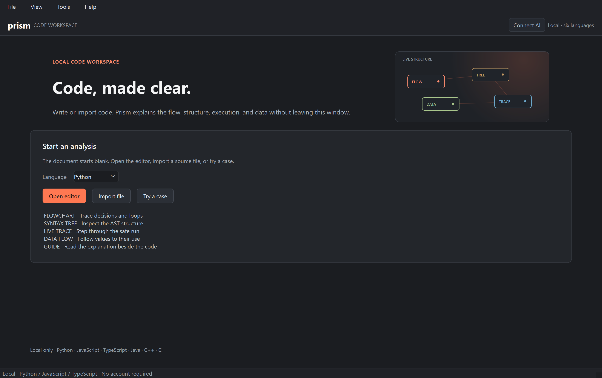
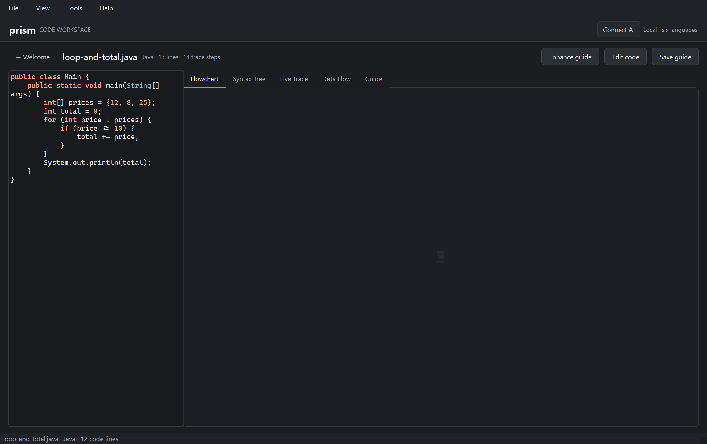

# Prism

**A native Python workspace for understanding code.**

Prism turns a source file into a linked set of views—flow, syntax, execution, and data—and explains the program in plain English. It is built for beginners, runs entirely on the local machine, and is implemented with **PySide6** rather than a browser runtime.



## Highlights

- **Six languages** — Python, JavaScript, TypeScript, Java, C++, and C.
- **Four linked views** — Flowchart, Syntax Tree, Live Trace, and Data Flow.
- **Structural compare** — diff two versions of one file by classes and functions instead of by lines, powered by [structscope](https://pypi.org/project/structscope/).
- **Beginner's guide** — overview, mental model, step-by-step walkthrough, line-by-line notes, concepts, common mistakes, and a quick check.
- **Native motion** — page and tab transitions, sequenced flowchart nodes, trace-detail fades, and a drifting welcome illustration.
- **Optional AI** — add a second explanation with OpenAI-compatible, DeepSeek, Grok, Anthropic, or Gemini. Local analysis needs no AI.
- **Bilingual interface** — switch between English and 简体中文 from the top bar; the window re-labels itself without a restart.
- **Local-first** — source code is parsed and simulated in-process. No account, telemetry, or browser tab required.
- **Source-only** — the project is a Python application, not a web wrapper.

## Supported languages

| Language | Parser | Analysis module |
| --- | --- | --- |
| Python | Python `ast` | `python_app/analysis.py` |
| JavaScript | tree-sitter | `python_app/js_analysis.py` |
| TypeScript | tree-sitter | `python_app/js_analysis.py` |
| Java | tree-sitter | `python_app/compiled_analysis.py` |
| C++ | tree-sitter | `python_app/compiled_analysis.py` |
| C | tree-sitter | `python_app/compiled_analysis.py` |

The trace is a safe, bounded interpreter—not an execution of the original program. It covers common beginner constructs such as variables, arithmetic, conditions, loops, functions, returns, and print output. See [Limitations](#limitations) for the deliberately excluded surface.

## Quick start

Requires **Python 3.11 or newer** on Windows.

```powershell
python -m pip install -r python_app\requirements.txt
python python_app\launch_native.py
```

No installer is included; this is the source-only distribution.

The app opens with a blank document. Choose a language, then:

- **Open editor** to write code.
- **Import file** to load a source file.
- **Try a case** to start from a small example.
- **Compare versions** to diff two versions of one file by structure.

## Usage

1. Select a language from the welcome screen.
2. Open the editor, import a file, or load an example.
3. Press **Visualize & explain**.
4. Explore the results:

   - **Flowchart** — follow decisions, loops, and the order of statements.
   - **Syntax Tree** — inspect the structural tree of the parsed program.
   - **Live Trace** — step through values, variables, output, and loop iterations.
   - **Data Flow** — see assignments and the names they depend on.
   - **Guide** — read the generated explanation from top to bottom.

5. Use **Enhance guide** to request an optional AI explanation.
6. Use **Save guide** to export the generated guide as Markdown.



## Interface language

The language box in the top-left of the window switches the interface between
English and 简体中文. The choice applies immediately — menus, buttons, status
lines and dialogs are re-labelled in place, with no restart — and is remembered
for the next launch.

Strings live in `python_app/i18n.py` as one dictionary per language, keyed by the
English text. Adding a language means adding one dictionary; a test walks the UI
modules and fails when a `tr(...)` string has no translation, so the table cannot
silently drift behind the interface. Code-level names (Python, Java, C++) stay
untranslated on purpose, and the explanation text Prism generates for a program
remains in English.

## Compare two versions

Prism can diff two versions of the same file by **structure** instead of by
lines. Open **Compare versions** on the welcome screen, or use
**Tools → Compare two versions…** (`Ctrl+D`).

1. Pick the language, then choose a *before* file and an *after* file — or
   press **Sample pair** to load the bundled example for Python or Java.
2. Press **Compare**.
3. Read the map: every class, function and method appears twice — once per
   version — joined by a curve when the two sides matched.

| Colour | Meaning |
| --- | --- |
| green | added in the after version |
| red | removed from the before version |
| amber | same symbol, changed body or signature |
| blue | same body, different name (moved) |
| grey | unchanged |

Card width tracks the number of code lines, and the complexity badge appears
when a symbol got more or less branching. Hover a card to lift it, light up its
partner on the other side and dim everything else — the pair you are looking at
stays readable however crowded the map gets. Click any card to see the two
excerpts aligned line by line, with added, removed and replaced lines toned
differently. The filter next to the language box dims everything except one
status, which makes "what actually changed" readable at a glance.

The diff itself comes from [structscope](https://pypi.org/project/structscope/),
a small library that matches symbols across two parses. Prism already builds
the trees, so no second parser is involved: `compare_engine.py` adapts Prism's
analysis trees into structscope's symbol model.

If `structscope` is not installed the Compare page explains what to run:

```console
pip install structscope
```

While working on both projects side by side, install the checkout instead:

```console
pip install -e ..\structdiff
```

## Optional AI

Open **Connect AI** in the top bar, or **Tools → Connect AI**.

| Provider | Base URL | Default model |
| --- | --- | --- |
| OpenAI / compatible | `https://api.openai.com/v1` | `gpt-6.1-terra` |
| DeepSeek | `https://api.deepseek.com/v1` | `deepseek-flash` |
| Grok (xAI) | `https://api.x.ai/v1` | `grok-4.7` |
| Anthropic | `https://api.anthropic.com` | `claude-fable-5-2` |
| Google Gemini | `https://generativelanguage.googleapis.com` | `gemini-4-hydrogen` |

Model IDs change frequently. The model field is editable, so use the identifier published by your provider.

1. Choose a provider.
2. Confirm the base URL and model.
3. Enter an API key when the provider requires one.
4. Use **Test connection**.
5. Press **Save**, then **Enhance guide** from the results header.

The request is sent only when you explicitly test a connection or enhance a guide. The key is used for that request and is not written to logs. **Remember the key on this device** stores it in the local Qt settings store.

## Architecture

```text
python_app/
  native_app.py          PySide6 window, editor, views, guide, dialogs
  analysis.py            Python AST analysis, safe trace, guide generator
  js_analysis.py         tree-sitter JavaScript/TypeScript analysis and trace
  compiled_analysis.py   tree-sitter Java/C++/C analysis and trace
  compare.py             Compare page: two-version map and aligned excerpts
  compare_engine.py      Prism trees -> structscope symbol model, structural diff
  i18n.py                Interface strings: English source text + translations
  ai.py                  Optional AI provider calls and validation
  launch_native.py       Application entry point
  requirements.txt       PySide6 and tree-sitter grammars
tests_py/
  test_analysis.py
  test_javascript.py
  test_compiled.py
  test_ai.py
  test_compare.py
  test_i18n.py
samples/                 before/after pairs used by the Compare page
assets/                  Application icon
screenshots/             Native app screenshots
```

### Design principles

- **One process, one language.** The UI, parser adapters, trace engines, guide generator, and AI calls are all Python.
- **Native rendering.** Diagrams are drawn with `QGraphicsScene`; the editor, trees, tables, and guide are native Qt widgets.
- **Bounded execution.** Traces have step, loop, and source-size limits. Unsupported constructs stop the trace rather than producing invented values.
- **No browser runtime.** There is no HTML/CSS/JS application layer, no Electron, and no Node dependency.
- **Local by default.** AI is an optional outbound request, never a background process.

## Tests

```powershell
python -m unittest discover -s tests_py -v
```

**39 tests currently pass.** They cover Python, JavaScript, TypeScript, Java, C++, and C analysis; trace output; guide generation; syntax errors; AI settings validation; empty input; the structural compare engine (model mapping, statuses, renames, line alignment); and the interface strings, including a coverage test that fails when a `tr(...)` string has no translation.

## Troubleshooting

- **`ModuleNotFoundError: PySide6` or `tree_sitter`** — install the requirements with `python -m pip install -r python_app\requirements.txt`.
- **No source file imports** — use the file dialog or drag support is intentionally not implemented in this native edition; use **Import file**.
- **Trace stops early** — the code uses a construct outside the bounded beginner subset. The structural views and guide remain available.
- **AI connection fails** — verify the base URL, model ID, API key, and network access. The local guide does not depend on AI.

## Limitations

- The compiled-language trace supports a beginner subset. Complex generics, pointer arithmetic, macros, multithreading, and exception-heavy Java are not fully interpreted.
- JavaScript and TypeScript coverage is intentionally conservative; some higher-order and dynamic constructs are outside the trace subset.
- The flow and data views are explanatory diagrams, not compiler-grade control-flow graphs or SSA.
- Source snippets are capped at 60,000 characters.
- AI output depends on the selected provider and model. The local guide remains available if a request fails.
- The app targets Windows 10/11 x64.

## More screenshots

### Beginner's guide


### Optional AI settings


## License

No license file is included in this workspace. Add the license appropriate for your distribution before publishing.
